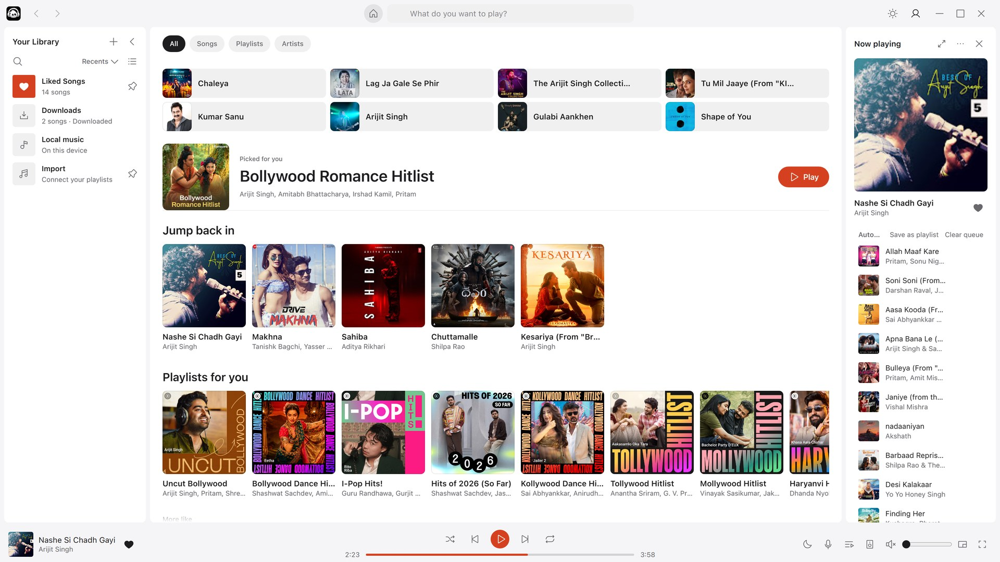
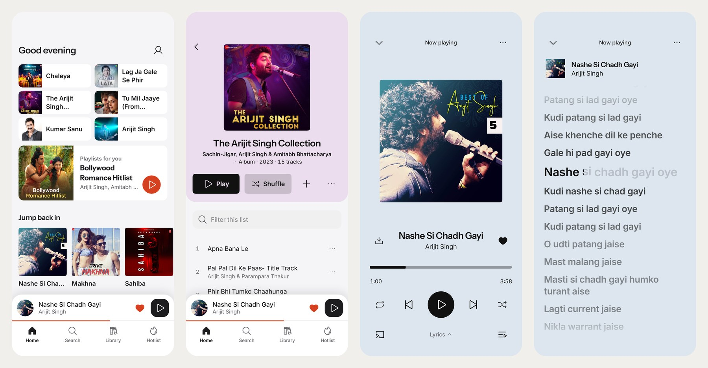

<p align="center">
  
</p>

<h1 align="center">Hushio</h1>

<p align="center">
  A free music player for Windows, macOS, Linux and Android.<br>
  No ads, no account, and your library stays on your device.
</p>

<p align="center">
  <a href="https://github.com/Nexvyn/hushio/releases/latest"></a>
  <a href="https://github.com/Nexvyn/hushio/releases"></a>
  <a href="https://github.com/Nexvyn/hushio/actions/workflows/ci.yml"></a>
  <a href="LICENSE"></a>
</p>

<p align="center">
  <a href="https://github.com/Nexvyn/hushio/releases/latest"><b>Download</b></a> ·
  <a href="https://hushio.nexvyn.dev">Website</a> ·
  <a href="CONTRIBUTING.md">Contribute</a> ·
  <a href="https://github.com/Nexvyn/hushio/issues/new/choose">Report a bug</a>
</p>





## Download

Get the latest version from the [Releases page](https://github.com/Nexvyn/hushio/releases/latest).

| Platform | File |
|---|---|
| Windows 10 and 11 | `Hushio-<version>-x64-setup.exe` |
| macOS 13 or later, Apple silicon | `Hushio-<version>-arm64.dmg` |
| macOS 13 or later, Intel | `Hushio-<version>-x64.dmg` |
| Linux, Debian and Ubuntu 22.04 or later | `Hushio-<version>-linux-amd64.deb` |
| Linux, Fedora and openSUSE | `Hushio-<version>-linux-x86_64.rpm` |
| Android 8 or later | `hushio-<version>-universal.apk` |

On Android, the universal APK works on every phone. The `arm64-v8a` APK is smaller and fits almost every phone made since 2017.

The builds are not signed by Apple or Microsoft yet, so the first launch needs one extra step:

- Windows: if SmartScreen appears, choose More info, then Run anyway.
- macOS: open the app once, then go to System Settings, Privacy & Security, and choose Open Anyway.
- Android: allow "Install unknown apps" for your browser or file manager when asked.

The Windows app updates itself. On macOS, Linux and Android, Hushio tells you when a new version is out and links to the download. Each release has a `SHA256SUMS.txt` file to check your download against.

## Features

### Listening
- Search songs, albums, artists, playlists and videos, with suggestions as you type and recent searches.
- Search online, in your own music on the device, or in add-on sources.
- A queue with drag to reorder, swipe to remove, play next, shuffle, repeat and endless Autoplay of similar songs.
- Start a radio from any song.
- Crossfade on desktop, playback speed and a sleep timer that can stop at the end of a song.
- Streaming quality you can set separately for Wi-Fi and mobile data, plus a data saver.

### Discover
- Home with quick picks, a featured playlist, recent plays and shelves made for you.
- Charts (Hotlist on the phone), New releases and a Daylist that changes through the day.
- Artist pages with top songs, albums, singles and an About card.
- Replay, a yearly and monthly recap of what you listened to.
- Listening History, grouped by day, with remove from history.

### Library
- Liked Songs, playlists and followed artists, shown as a grid or a list.
- Create, rename, reorder and pin playlists. Filter long playlists and albums by title or artist.
- Import from a text list, CSV, a playlist link, Apple Music or Spotify. Songs are matched to Hushio's catalogue. Export a playlist as M3U8 or JSON.
- Downloads for offline listening, with Wi-Fi only downloads and downloaded playlists kept up to date.
- Your own music folders, and music on network shares.

### Lyrics
- Synced lyrics from several sources, with word-by-word highlighting.
- Translations when the lyrics include them, and romanised text for other scripts.
- Lyrics timing adjustment per song.

### Now Playing
- Swipe the cover to skip, double-tap to like, swipe up for lyrics and swipe down to close.
- Animated covers when available.
- Song info, Share, Add to playlist and Download from the song menu.
- Cast to Chromecast and Google TV devices.

### Sound
- Equaliser with presets, loudness levelling and skip silence.

### Desktop
- Your library on the left, the current song and the queue on the right, and a player bar along the bottom.
- Media keys, a mini player, a tray icon and keyboard shortcuts.
- Discord status (optional).

### Android
- Background playback with notification and lock-screen controls (play, pause, next, previous, like).
- Home-screen widgets in three sizes.
- Android Auto.
- Gestures throughout: long-press for menus, swipe rows to queue or like, pull to refresh, edge swipe back.
- Built-in update check.

### Accounts and sync (all optional)
- Google sign-in to sync playlists and back up your library to your own Google Drive.
- Scrobbling to Last.fm and ListenBrainz.
- Backup export and import.

Google sign-in, connecting a Spotify account, Last.fm and Discord status need API keys that the 1.0.0 downloads do not include yet. They work in your own build once you add keys, as [CONTRIBUTING.md](CONTRIBUTING.md#optional-api-keys) explains.

### Look and feel
- Light, dark or system theme, with a calm white design and one accent colour.
- Every animation respects the system Reduce Motion setting.

## How it works

Hushio has no servers of its own. The app searches and plays music from YouTube Music's public catalogue, talking to YouTube straight from your device in the same way the YouTube Music website does. Lyrics come from public lyrics services such as LRCLIB, LyricsPlus and Genius.

Your library, playlists, listening history and settings live in the app's data folder on your device. Hushio has no analytics. If you sign in with Google, the app talks to Google directly with your own account, and Settings has a button to disconnect and erase everything.

## Build from source

You need Node.js 22, pnpm 10, Rust (stable) and the [Tauri 2 prerequisites](https://v2.tauri.app/start/prerequisites/) for your system. Android builds also need Android Studio's SDK and NDK, and Java 17.

```sh
pnpm install
pnpm dev            # run the desktop app
pnpm test           # frontend tests
pnpm tauri build    # desktop installer
pnpm android:apk    # Android APKs
```

Rust tests: `cargo test` inside `src-tauri`.

## Contributing

Bug reports, ideas and pull requests are welcome. Read [CONTRIBUTING.md](CONTRIBUTING.md) to set up the project and see how changes get merged. Please follow the [code of conduct](CODE_OF_CONDUCT.md). To report a security problem, see [SECURITY.md](SECURITY.md).

## Disclaimer

Hushio is an independent project. It is not affiliated with, endorsed by or connected to YouTube, Google, Spotify, Apple or any lyrics service. All trademarks belong to their owners. Use Hushio in line with the terms of the services it connects to.

## License

GPL-3.0. See [LICENSE](LICENSE).
